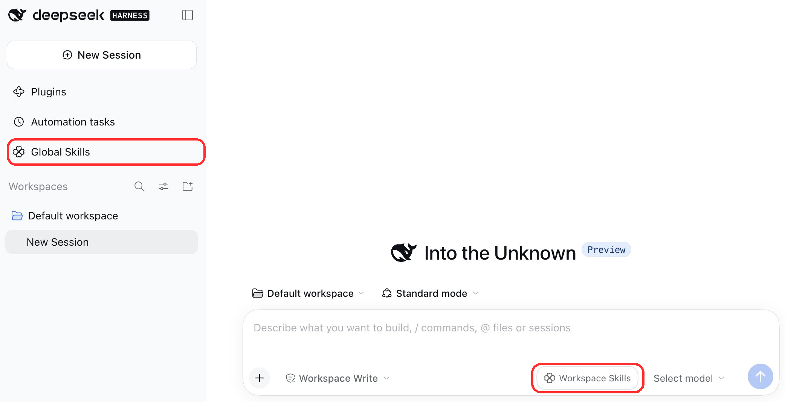
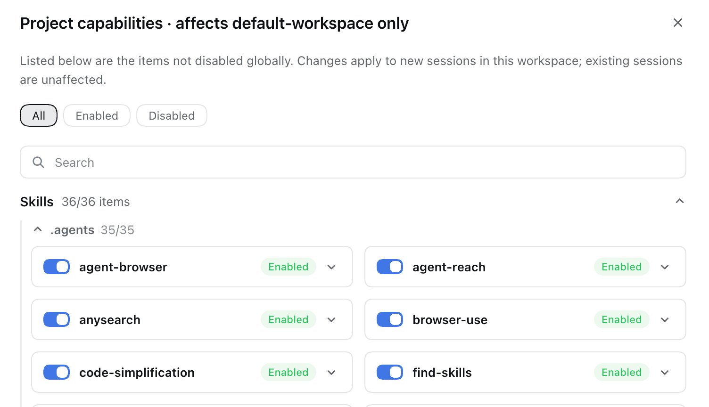

<div align="center">

# dsh-skill-scope: a Skill and MCP control panel for DSH

[](LICENSE)
&nbsp;

&nbsp;


**One-click toggles for skills and MCP at both global and project scope**

**English** · [简体中文](README.md)
</div>

---

## Installation

```sh
dsh plugin --profile web add @dotdance/dsh-skill-scope
```

Replace `--profile web` with the name of your own profile.


## The problem it solves

The more you install in DSH, the longer the list your agent has to read every turn.

- Your user-level skill directory accumulates **N+ skills**, of which only a few help the task at hand.
- Every MCP server pushes **all of its tools** into the model's tool table, even when none are used this turn.
- A coding project and a writing workspace need **entirely different** skills and MCP servers.
- You want "this project uses only these capabilities", but there is no switch for that — an installed skill is globally visible.

The cost is not cosmetic. It is real:

| Cost | Why |
| --- | --- |
| **Burned tokens** | The skill list and the MCP tool table re-enter context every turn; the more you install, the higher the fixed per-turn overhead |
| **Diluted attention** | Too many candidates make the model likelier to pick the wrong tool or miss the relevant one |
| **An unclean context** | Unrelated capabilities mixed into the prompt make results harder to predict and harder to debug |
| **Cross-project contamination** | A capability only project A needs keeps occupying space in project B |

**dsh-skill-scope exists for exactly this**: it turns "which skills and MCP servers the model can call" into a set of
visible, clickable switches, managed separately at **global** and **per-workspace** scope.

---

## What it does

### 1. The global panel — switch off everything no project needs

Click **Global Skills** in the left sidebar to open a native main-view page listing everything at the
**global layer**, skills and MCP servers alike. Anything you switch off here **is off by default in every workspace**;
when one project really needs it, that project can switch it back on (see rule 3).



The red circles above mark the two entry points: **Global Skills** in the left sidebar, and **Workspace Skills** at the bottom right of the input box.

- The row at the top is a **view filter** (All / Enabled / Disabled) — it only filters the list, it changes no switch.
- The search box **filters both the Skill and the MCP sections**, live as you type.
- The list groups and collapses by source, so even a long inventory stays navigable.

### 2. The project panel — keep only what this one project needs

In a **new session**, click **Workspace Skills** at the bottom right of the input box to open the project-scoped overlay (it floats above the current view):



The panel title states that it affects `default-workspace` only, and the lower part groups items by source: in this example the `.agents` directory contributes 35 of them.

- This list holds **the same inventory as the global panel**: items switched off globally are here too (with the switch off), and you can switch them on right here.
- A row that differs from the global setting carries a red **"Differs from global"** tag, so you can see at a glance what this project has changed.
- Besides **All / Enabled / Disabled**, the view bar has a fourth button, **Differs from global**: it narrows the list to what this project changed, which helps once the inventory gets long.
- Changes **apply only to new sessions in this project** and affect no other project.

### 3. The key rule: global supplies defaults, a project overrides item by item

```text
      Every skill and MCP server on disk
                │
                ▼
      ┌─────────────────────┐
      │  Global (defaults)  │   off = no project uses it by default
      └─────────────────────┘
                │  per item: follow / switch on / switch off
                ▼
      ┌─────────────────────┐
      │  Project (override) │   can switch a global off back on,
      └─────────────────────┘   and a global on back off
                │
                ▼
      The set the model actually sees this turn
```

Each item has one of three states in a project. The panel exposes a single control, because
"follow global" is expressed by **not recording that item**:

| State | Meaning | How the panel shows it |
| --- | --- | --- |
| Follow global | This project has no opinion on the item | Switch sits at the global position, no red tag |
| Switched on here | Off globally, but this project needs it | Switch is on + red tag "Differs from global" |
| Switched off here | On globally, but this project does not want it | Switch is off + red tag "Differs from global" |

To go back to "follow global", move the switch to the global position: the red tag disappears and the
record is dropped.

### Off is not deleted: manual invocation always remains

Switching a skill off only disables its **automatic invocation by the model**. You can still call it by typing `/name` in a session.

---
